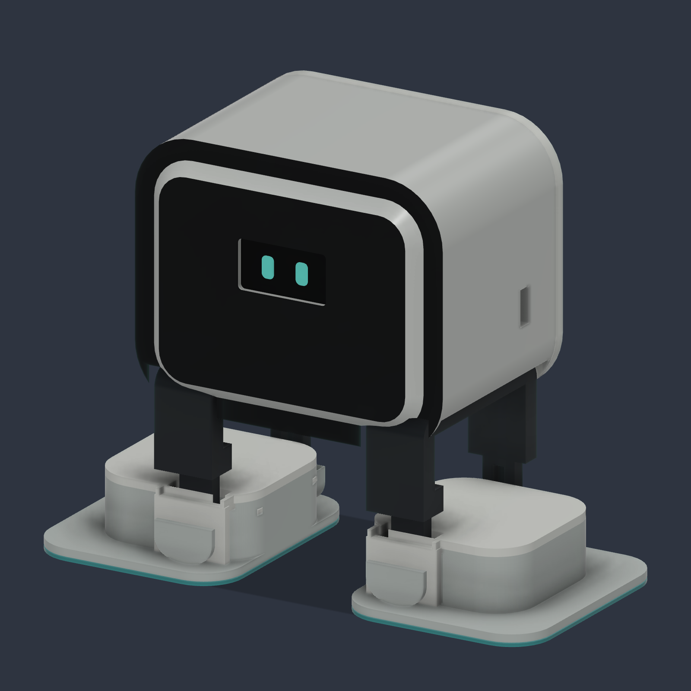
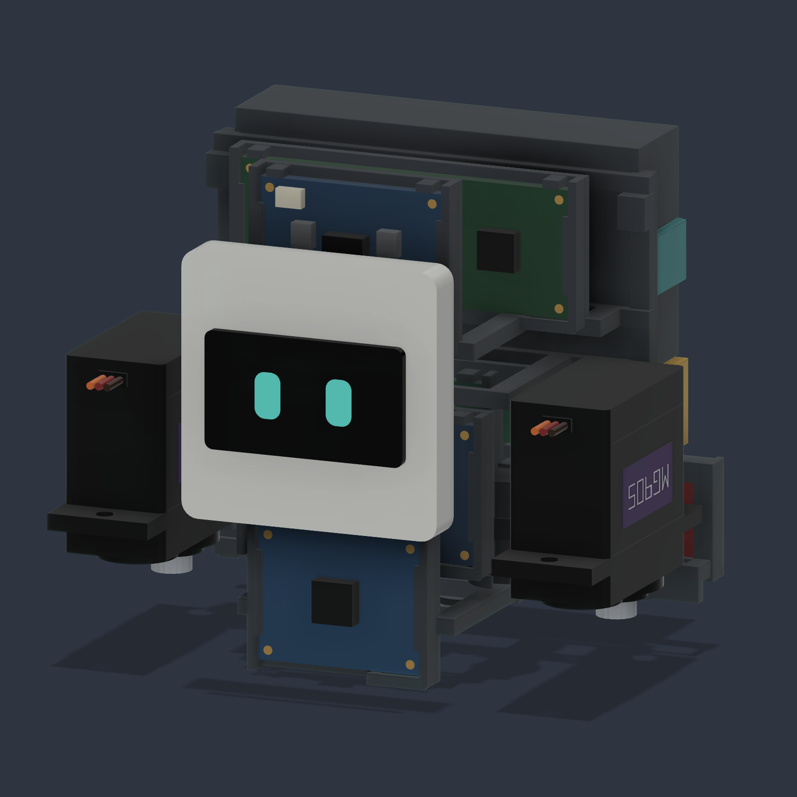

# emo-desk-robot

A small four-servo desk robot with an OLED face: Fusion 360 model, print-ready STLs, electronics layout and assembly notes.

  
  

## Design

- Box head with a 0.96″ OLED face, two U-shaped legs and two feet, driven by 4 × MG90S servos: two hip servos in the head (±15°) and two ankle servos lying flat inside the feet (±12°).
- 130 × 104 × 60 mm overall; the head is 80 × 65 × 56 mm.
- No visible screws. The only fasteners are the four hidden servo-horn screws; covers close with clips and two squeeze releases.
- Removable electronics cassette: ESP32-C3 SuperMini, OLED and IMU on I²C, DFPlayer with a speaker, 1S 650 mAh LiPo with a protection board, 5 V boost converter, USB-C charging and a physical RUN / OFF / CHARGE switch.
- Started from my original body model (`Original-user-backup.f3d`). The Fusion 360 API scripts in `emo-complete/Fusion-source/` rebuild the full assembly from it.
- Rendered in three finishes — Cloud, Night and Sage — on the same geometry.

## Files

| Path | Contents |
|---|---|
| `emo-complete/Emo-Complete.f3d` | Current design: Fusion 360 assembly with 4 joints |
| `emo-complete/Emo-Complete-print.step`, `*.stl` | The 17 printed parts only |
| `emo-complete/parts.csv` | Parts list |
| `emo-complete/*.md` | Assembly and printing, parts and shopping, power and wiring (Romanian) |
| `emo-complete/*-validation.json` | Collision, insertion, reload and mesh checks |
| `variants/` | Earlier drive layouts: `foot-drive`, `head-drive`, `direct-drive`, `4-servo` |
| `figurine/` | Static figurine of the original body — Bambu Studio projects for the P1S |

## Printing

Robot — 17 parts on a Bambu Lab P1S with a 0.4 mm nozzle:

| Parts | Material | Settings |
|---|---|---|
| Head, rear cover, hip rack, OLED carrier, electronics cassette, 2 legs, 2 feet, 2 foot lids (11) | PETG | 0.16–0.20 mm layers, 4 walls, 5 top/bottom, 25–35 % infill |
| Battery bridge, speaker retainer, 2 axle caps, 2 soles (6) | TPU 95A | 0.20 mm layers, 3 walls, slow |

Don't use PLA for the clips that flex. Print one foot first and test the servo, horn, axle and lid fit before the rest. The hip rack and electronics cassette need local supports.

Figurine — `figurine/EMO_P1S_PLA_45pct_52min.3mf`, ready to print:

| Printer | Material | Settings | Result |
|---|---|---|---|
| Bambu Lab P1S, 0.4 mm | PLA | 0.20 mm, 2 walls, 8 % gyroid, tree supports, outer brim | 45 % scale: 58.5 × 27 × 46.8 mm, 52 min, 13.6 g |

A 60 % version (1 h 23 min) is in the same folder.

## Status

CAD prototype. Checked in Fusion: 49 joint poses with no collisions, servo and cassette insertion, and all 17 STLs closed and manifold. Not printed or assembled yet, and there is no firmware yet.

## License

[MIT](LICENSE)
