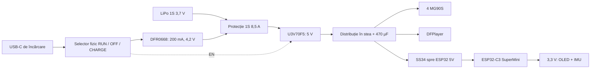

# Alimentare și cablare — arhitectura propusă

Proiectul este acum un robot cu patru servouri de poziție. ESP32-C3 comandă direct semnalele PWM; MX1508 și motoarele N20 din lista inițială nu sunt folosite în această variantă.

## Circuit de putere

Bateria aleasă ca referință este GNB6501S70A, LiPo obișnuită 1S, 650 mAh, 46 × 25 × 8,5 mm. Se cere varianta cu mufă de putere XT30, nu un conector mic destinat curenților de ordinul 1–2 A. Producătorul are o inconsecvență A30/XT30 în titlu și specificații; verifică fotografia și confirmarea variantei înainte de comandă. [Gaoneng](https://www.gaoneng.shop/products/gaoneng-gnb-1s-3.7v-650mah-70c-xt30-lipo-battery)

Celula se conectează la B+/B− ale protecției. **Toate** conexiunile externe, inclusiv încărcătorul, convertorul, USB și masa ESP32, folosesc bornele P+/P−. O masă externă legată direct la B− ar putea ocoli protecția de pe retur. Tenergy 32195 declară 8,5 A de lucru și prag de descărcare de aproximativ 2,8 V; acest prag este protecția de avarie, nu tensiunea normală de oprire a mersului. [Tenergy](https://power.tenergy.com/tenergy-1s-li-ion-8-5a-18a-pcb-discharging-cut-off-voltage-2-8v/)

U3V70F5 are ieșire nominală de 5 V și oprire reală la ENABLE. Limitele de 8/10 A din descriere privesc intrarea/comutația; ieșirea depinde de tensiunea bateriei, randament și temperatură. Rezervă un condensator de cel puțin 33 µF la intrare și unul de 470 µF lângă distribuția servourilor. Nu monta blocurile mari de terminale livrate: modelul presupune fire lipite direct și izolate. [Pololu](https://www.pololu.com/product/2891)

## Selector fizic: încărcare numai cu robotul oprit

Selectorul propus este C&K JS203011CQN, DP3T, fără suprapunerea contactelor. Folosește cele două secțiuni pentru semnale și alimentarea încărcătorului, **nu pentru curentul motoarelor**. Cota nominală este 0,3 A la 6 VDC; modulul de încărcare se setează la 200 mA. [C&K](https://www.ckswitches.com/media/1422/js.pdf), [DFRobot](https://www.dfrobot.com/product-2068.html)

| Poziție | Secțiunea A: ENABLE boost | Secțiunea B: VIN încărcător | Comportament |
|---|---|---|---|
| RUN | P+ | deconectat | Robot alimentat; încărcător fără VIN |
| OFF | P− | deconectat | Robot oprit, încărcare oprită |
| CHARGE | P− | USB 5 V | Robot oprit; încărcare la 200 mA |

Montează suplimentar 4,7 kΩ între ENABLE și P−. Cu rezistența internă de 100 kΩ spre VIN a convertorului, ENABLE rămâne sub 0,2 V la o baterie de 4,2 V când contactul este deschis. Identifică bornele comune și pozițiile selectorului cu un multimetru; nu te baza pe numerotarea altui model de comutator.

USB-C-ul nativ al DFR0668 rămâne ascuns în interior. Intrarea externă de încărcare ajunge la VIN **numai prin selector**. Nu folosi simultan portul USB nativ al încărcătorului, deoarece ar ocoli interblocarea. Intrarea modelată este SparkFun BOB-23055 vertical, cu flanșă PCB și câte o rezistență Rd de 5,1 kΩ deja montată pe CC1 și CC2. Nu adăuga încă o pereche în paralel. [Hardware SparkFun](https://github.com/sparkfun/SparkFun_USB-C_Vertical_Breakout)

Bornele BAT ale încărcătorului rămân pe P+/P−. TP4056X declară protecție la descărcare inversă și consum redus când VIN lipsește. Acesta nu este un circuit de alimentare a robotului în timpul încărcării. [Fișa TP4056X](https://www.toppwr.com/uploadfile/file/20240913/66e3a33eacaf5.pdf)

## ESP32, ecran și audio

| Funcție | GPIO propus | Observație |
|---|---:|---|
| Șold stâng / drept | 4 / 5 | PWM la 50 Hz |
| Talpă stângă / dreaptă | 6 / 7 | PWM la 50 Hz; verifică sensul după montaj |
| OLED + IMU SDA / SCL | 0 / 1 | Magistrală comună la 3,3 V |
| DFPlayer TX al ESP / RX al ESP | 21 / 20 | 1 kΩ în serie spre RX al DFPlayer |
| Măsurare baterie | 3 | P+ → 100 kΩ → ADC; ADC → 100 kΩ → P−; 100 nF la ADC |
| Rezervă | 10 | Nu lega direct la ENABLE în schema de mai sus |

GPIO2/8/9 sunt lăsate libere pentru a evita încărcarea pinilor de boot; USB nativ folosește GPIO18/19. GPIO4–7 nu mai sunt disponibile pentru JTAG extern. [Espressif](https://documentation.espressif.com/esp32-c3_datasheet_en.html)

Pune câte 1 kΩ pe cele patru semnale PWM și câte 100 kΩ la masă pe intrările de semnal ale servourilor. Rezistențele limitează curentul prin intrări când servourile sunt oprite; nu oferă izolare galvanică și nu garantează zero alimentare parazită. Firmware-ul trebuie să țină PWM și TX spre DFPlayer LOW sau în impedanță mare dacă bara principală de 5 V lipsește. Dezactivează/reconfigurează mesajele de boot UART înainte de a trimite comenzi DFPlayer.

SS34 se pune doar în ramura 5 V spre ESP32, cu anodul la bara principală și catodul la pinul 5 V al plăcii. Împiedică alimentarea înapoi a servourilor prin USB-ul ESP32; verifică schema lotului SuperMini înainte de cablare. Pune decuplare locală după diodă. OLED-ul și IMU-ul folosesc 3,3 V din ESP32. Difuzorul se leagă exclusiv între SPK1 și SPK2 ale DFPlayer; niciuna dintre aceste borne nu se leagă la masă. Un difuzor de 0,5 W cere limitarea nivelului audio. [DFRobot DFPlayer](https://wiki.dfrobot.com/dfr0299)

## Curent, autonomie și încercări

Pentru dimensionare s-a rezervat provizoriu 1 A pe servo la vârf, plus 0,6 A pentru logică/audio. Fișa TowerPro nu furnizează aici curentul de blocare al lotului cumpărat. Un vârf de 4,6 A la 5 V ar solicita aproximativ 8,2 A din 3,3 V la randament de 85%; se apropie de limita protecției și a convertorului. Nu este garantată susținerea simultană a patru servouri blocate. Oprește mersul la baterie descărcată și în caz de blocare; un prag inițial conservator este 3,5 V sub sarcină, de ajustat prin măsurători.

Cu o baterie de 650 mAh, energia nominală este aproximativ 2,4 Wh. Pentru 80% energie utilizabilă și 85% conversie, 1 A mediu la 5 V înseamnă aproximativ 20 minute; 2 A înseamnă aproximativ 10 minute. Sunt calcule de planificare, nu autonomie măsurată.

Înainte de închiderea carcasei: testează interblocarea RUN/OFF/CHARGE, polaritatea și protecția; verifică lipsa alimentării servourilor din USB-ul ESP32; măsoară căderea barei de 5 V la pornirea fiecărui motor și la mișcări combinate; urmărește temperatura convertorului și bateriei. Firele principale sunt de 20–22 AWG, cu distribuție în stea, iar firele din picioare au bucle libere și detensionare la ambele articulații.
